<p align="center">
  <a href="https://meetohmi.vercel.app/">
    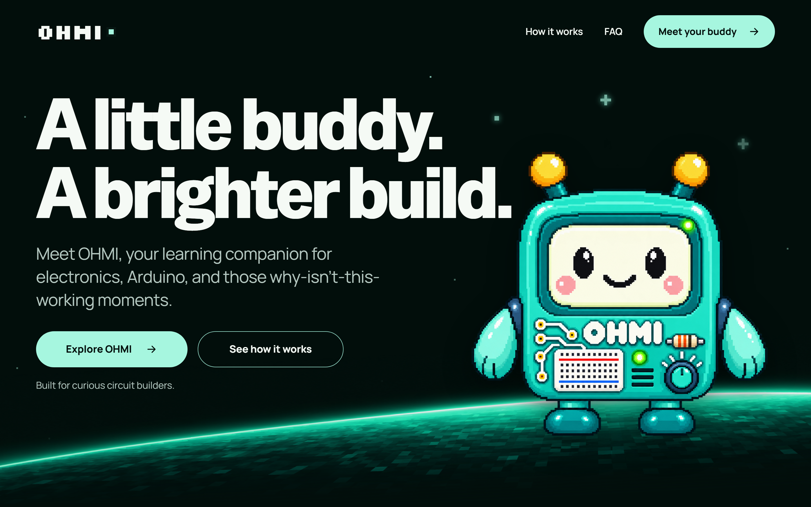
  </a>
</p>

<h1 align="center">OHMI — Your Circuit Buddy</h1>

<p align="center">
  <strong>An intelligent, interactive AI learning companion designed for students in Autodesk Tinkercad Circuits.</strong><br>
  <em>A little buddy. A brighter build. Step-by-step electronics guidance, right beside your circuit.</em>
</p>

<p align="center">
  <a href="https://meetohmi.vercel.app/"></a>
  <a href="https://github.com/janveryuu/OHMI"></a>
  <a href="https://www.typescriptlang.org/"></a>
  <a href="https://react.dev/"></a>
  <a href="https://supabase.com/"></a>
  <a href="#"></a>
</p>

<p align="center">
  <a href="#-explore-meetohmi">🌐 Companion Website</a> •
  <a href="#-key-features">✨ Features</a> •
  <a href="#-meet-ohmi">🤖 Meet OHMI</a> •
  <a href="#-ui--concept-design-gallery">🎨 Design Gallery</a> •
  <a href="#-system-architecture">🏗️ Architecture</a> •
  <a href="#-quickstart">🚀 Quickstart</a> •
  <a href="#-testing--verification">🧪 Testing</a>
</p>

---

## 🌟 Overview

**OHMI** is an open-source, AI-powered browser extension designed specifically for engineering students and electronics enthusiasts working inside **Autodesk Tinkercad Circuits**. 

Rather than switching tabs to search through dense datasheets or confusing forums, OHMI provides an in-editor floating robot companion that explains components, breaks down lab assignments, answers questions in conversational language (English, Filipino, or Taglish), and walks you through circuit construction one connection at a time.

```
                   +---------------------------------------+
                   |       Tinkercad Circuits Editor       |
                   |   (Wires, Breadboards, Arduino Uno)   |
                   +-------------------+-------------------+
                                       |
                   +-------------------v-------------------+
                   |         OHMI Floating Companion       |
                   |   * Draggable & Minimizable Mascot    |
                   |   * Isolated Shadow DOM Overlay       |
                   |   * Interactive Assistant Panel       |
                   +-------------------+-------------------+
                                       |
         +-----------------------------+-----------------------------+
         |                             |                             |
+--------v---------+          +--------v---------+          +--------v---------+
|   Assignments    |          |   Circuit Tutor  |          |  Companion Site  |
| Secure PDF & Img |          |  Multimodal AI   |          | meetohmi.vercel  |
| Storage via RLS  |          | Gemini & Groq    |          | Pure Vanilla Web |
+------------------+          +------------------+          +------------------+
```

---

## 🌐 Explore MeetOHMI

Experience the live companion landing page at 👉 **[meetohmi.vercel.app](https://meetohmi.vercel.app/)** — built with zero external runtime dependencies, ultra-fast loading, and interactive circuit demonstrations:

<p align="center">
  <a href="https://meetohmi.vercel.app/#explore">
    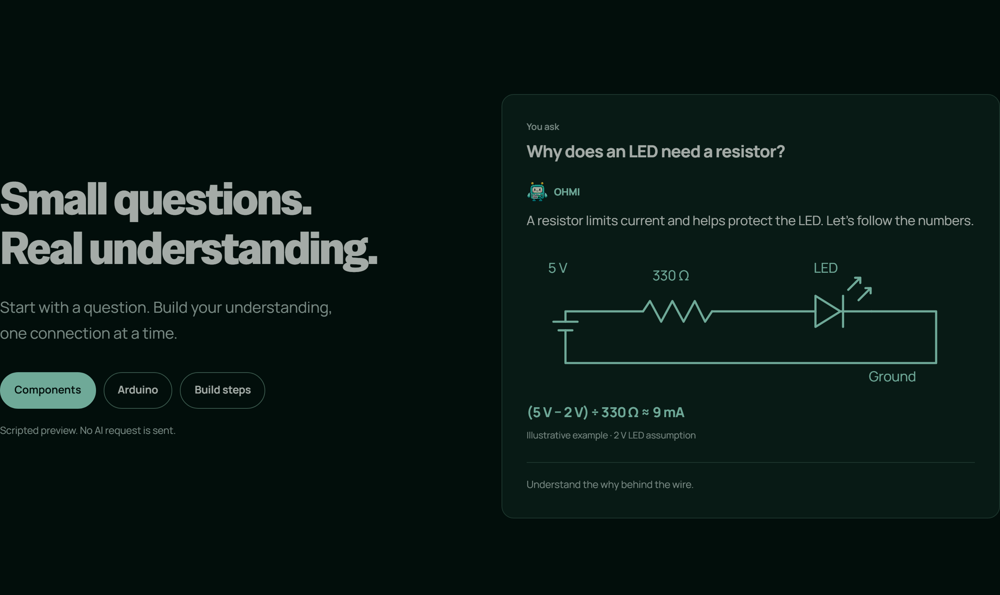
  </a>
</p>

- ⚡ **Live Interactive Circuit Math**: Test Ohm's Law in real-time with dynamic SVG schematics and formula breakdowns ($(5\text{ V} - 2\text{ V}) / 330\ \Omega \approx 9\text{ mA}$).
- 💡 **Interactive Arduino Code**: Inspect live syntax-highlighted Arduino Uno blink sketches with step-by-step logic explanations.
- 📋 **Build Step Checklists**: Follow structured milestone wiring guides before simulating in Tinkercad.
- 👀 **Animated Pupil Gaze**: Responsive eyes track your cursor movement across the viewport with strict `prefers-reduced-motion` compliance.
- 🚀 **Zero Build Dependencies**: Authored in pure semantic HTML5, modern CSS3, and vanilla JavaScript—deployed globally on Vercel.

---

## ✨ Key Features

<table>
  <tr>
    <td width="50%">
      <h3>⚡ Floating Circuit Companion</h3>
      <ul>
        <li>Appears non-intrusively in your Tinkercad Circuits editor.</li>
        <li>Draggable, minimizable, with keyboard navigation (Shift + arrow keys for pixel precision).</li>
        <li>Built in an isolated <strong>Shadow DOM</strong> to guarantee Tinkercad's native tools and simulation canvas are never blocked or styled over.</li>
        <li>Full dark and light mode themes with custom palette accents.</li>
      </ul>
    </td>
    <td width="50%">
      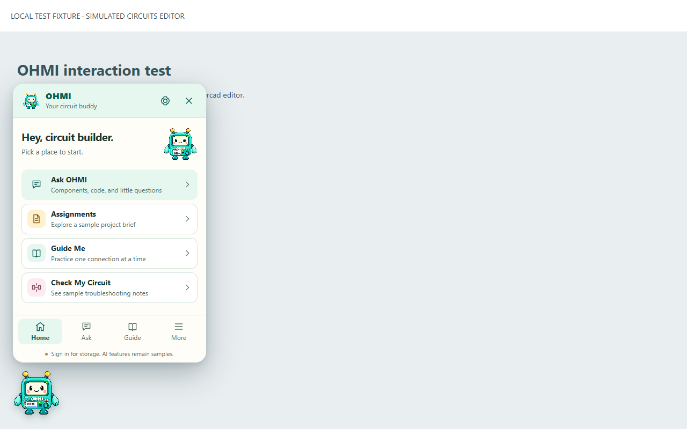
    </td>
  </tr>
  <tr>
    <td width="50%">
      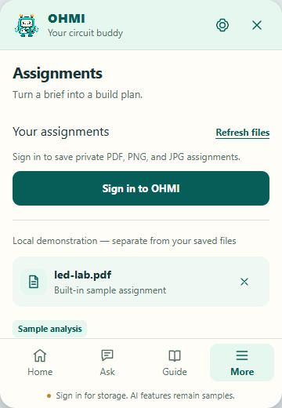
    </td>
    <td width="50%">
      <h3>📁 Assignment Hub & File Management</h3>
      <ul>
        <li>Upload lab assignment files in <strong>PDF, PNG, or JPG</strong> up to 10 MiB.</li>
        <li>Backed by secure Supabase Storage with signed 60-second download links.</li>
        <li>Persistent student progress, saved steps, and notes synchronized to your private cloud account.</li>
        <li>All uploads remain strictly isolated per student account.</li>
      </ul>
    </td>
  </tr>
  <tr>
    <td width="50%">
      <h3>💬 Interactive AI Circuit Tutor</h3>
      <ul>
        <li>Powered by Google Gemini 2.5 Flash with multimodal diagram analysis and Groq fallback.</li>
        <li>Understands component ratings, pin configurations, and Arduino microcontroller sketches.</li>
        <li>Provides intuitive analogies, mathematical breakdowns, and pin-to-pin wiring hints.</li>
        <li>Trilingual support: <strong>English, Filipino, and Taglish</strong> (<em>"Tara, himayin natin!"</em>).</li>
      </ul>
    </td>
    <td width="50%">
      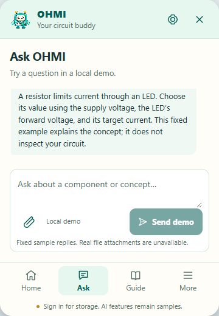
    </td>
  </tr>
  <tr>
    <td width="50%">
      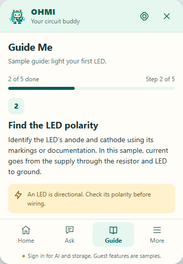
    </td>
    <td width="50%">
      <h3>📋 Step-by-Step Build Guides</h3>
      <ul>
        <li>Structured milestone checklist for complex circuits.</li>
        <li>Numbered connection instructions preventing fried components or miswired ICs.</li>
        <li>Check off completed steps as you place wires in Tinkercad.</li>
        <li>Retains your current step progress even across browser reloads.</li>
      </ul>
    </td>
  </tr>
</table>

---

## 🤖 Meet OHMI

OHMI is not a generic corporate assistant—OHMI is an approachable, cheerful electronics robot designed in handcrafted pixel art!

<p align="center">
  
</p>

### The Character Identity
- **Name**: **OHMI** (inspired by Ohm's Law $\Omega$).
- **Visual Style**: Clean, crisp 2D pixel-art aesthetic.
- **Palette**: Mint body, cream CRT face screen, black oval eyes, blush pink cheeks, yellow-tipped antennae, and teal extremities.
- **Chest Plate Detail**: Mini breadboard graphic with positive/negative power rails, resistor markings, a green active LED, and a teal potentiometer dial.
- **Personality**: Patient, encouraging, and clear. Never condescending; always ready to help you trace that one ground wire you forgot.

### Canonical Turnaround Reference
<p align="center">
  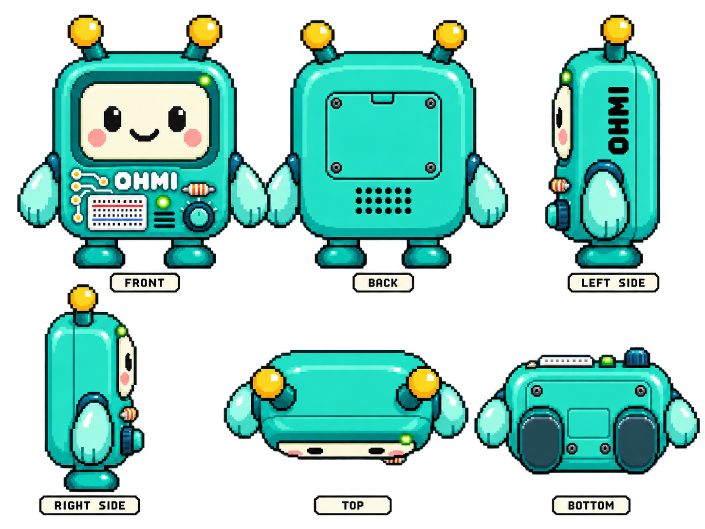
</p>
<p align="center"><em>Official six-angle turnaround sheet (Front, Back, Left, Right, Top, Bottom) preserved in <code>assets/mascot/</code>.</em></p>

---

## 🎨 UI & Concept Design Gallery

During OHMI's visual development, several UI/UX design concepts were created and benchmarked to craft the most legible, delightful learning experience:

| Concept C: Spark (Selected & Live) | Concept A: Orbit | Concept B: Workbench |
| :---: | :---: | :---: |
| 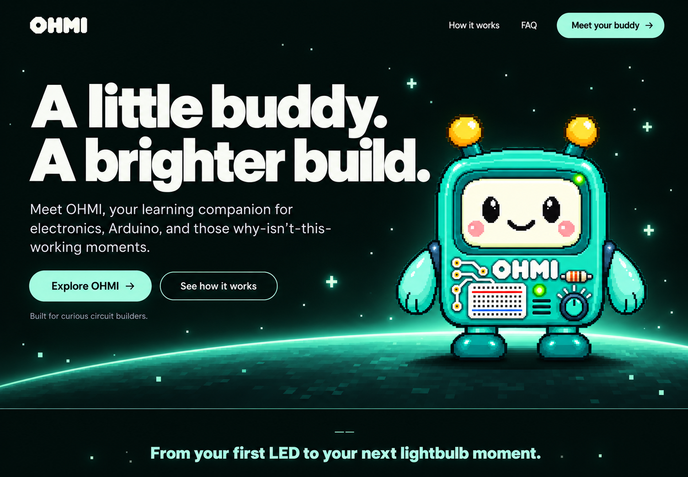 | 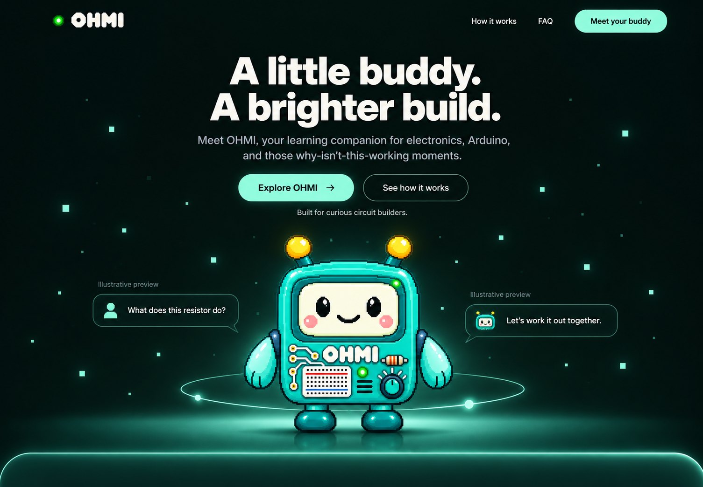 | 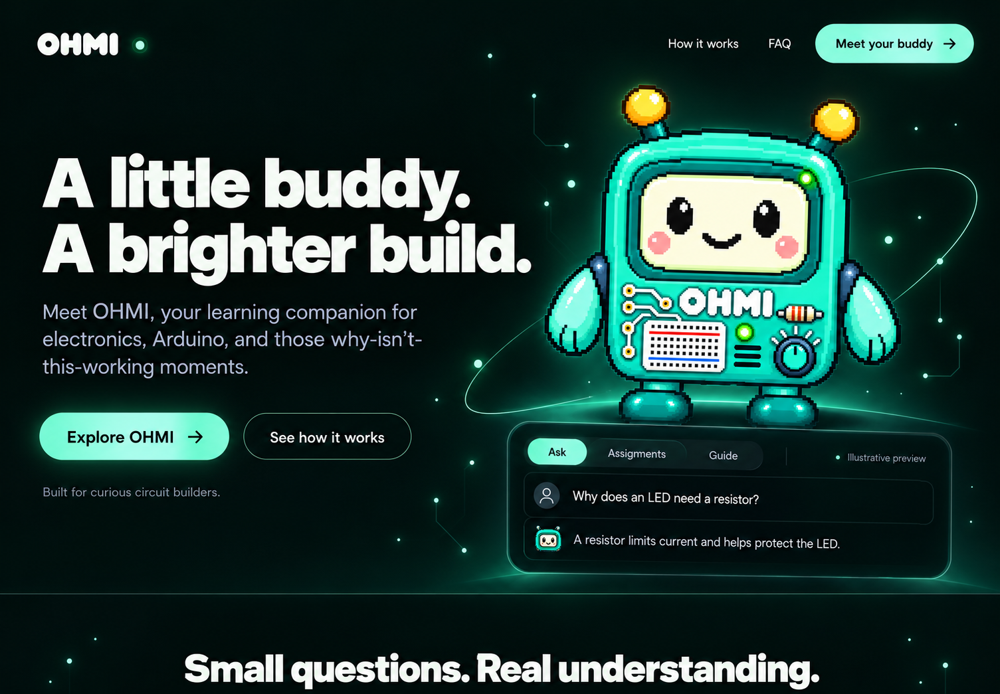 |
| *High-contrast emerald & mint horizon* | *Minimalist circular orbital layout* | *Hardware blueprint & workshop aesthetic* |

### Website Interactive Flow Preview
<p align="center">
  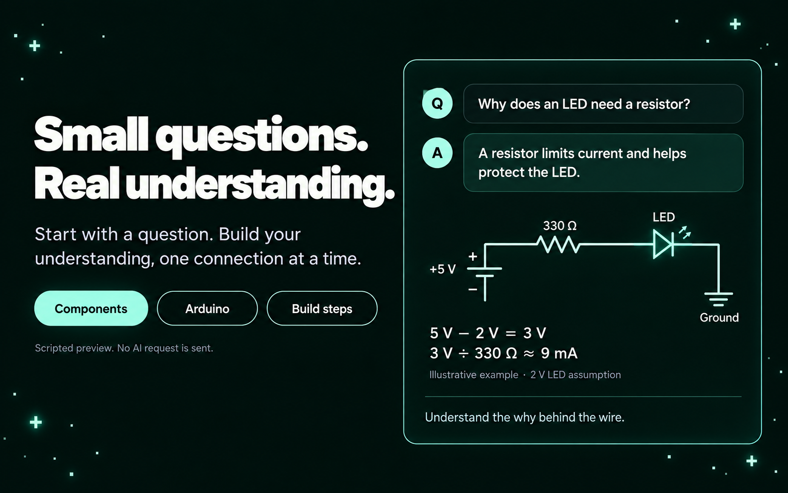
  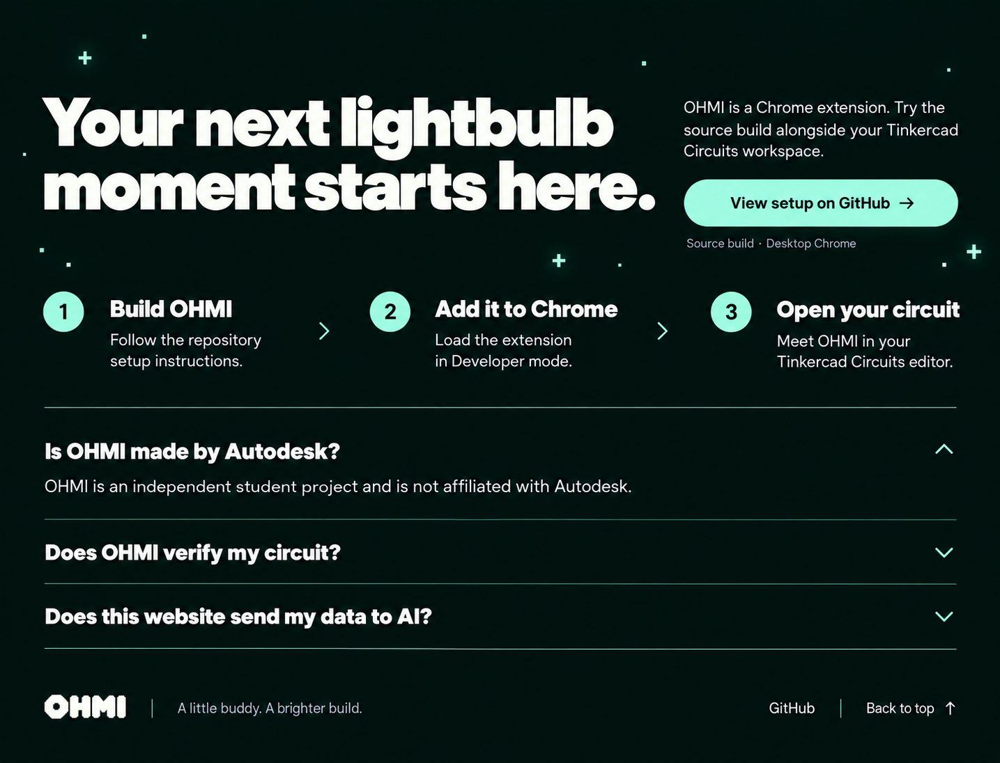
</p>

---

## 🏗️ System Architecture

OHMI is architected with modern web standards, strict security boundaries, and lightweight dependencies:

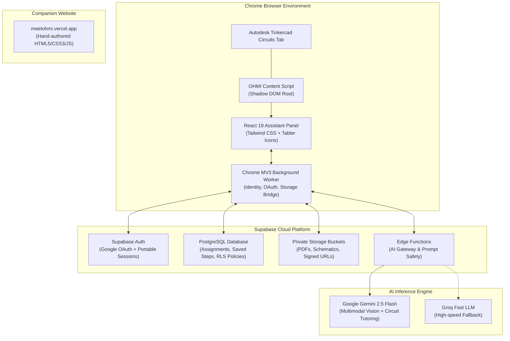

### 🛡️ Privacy & Security First
- **No Autodesk Affiliation**: OHMI operates as an independent client-side companion. It never accesses Tinkercad credentials, passwords, or Autodesk account data.
- **Zero Host Contamination**: Uses Web Component Shadow DOM encapsulation so host Tinkercad CSS and DOM events never leak into OHMI, and OHMI styles never distort Tinkercad.
- **Row Level Security (RLS)**: Every student's uploaded assignments and circuit steps are locked under strict PostgreSQL RLS policies. Only the authenticated owner can access their files.
- **No Direct Credential Exposure**: Client code only uses public Supabase publishable keys; all LLM keys and admin credentials reside in secured Edge Functions.

---

## 🛠️ Tech Stack

| Domain | Technology | Purpose |
| :--- | :--- | :--- |
| **Extension Framework** | [WXT](https://wxt.dev/) (Vite 8) | Next-gen Chrome Manifest V3 framework with HMR and type-safe entrypoints |
| **Frontend UI** | [React 19](https://react.dev/) + [TypeScript](https://www.typescriptlang.org/) | Modern component architecture, state management, and type safety |
| **Styling** | [Tailwind CSS](https://tailwindcss.com/) | Scoped utility styling inside Shadow DOM with accessible dark mode |
| **Backend & Auth** | [Supabase](https://supabase.com/) | PostgreSQL, Google OAuth, Row Level Security, Storage Buckets |
| **AI Intelligence** | Gemini 2.5 Flash & Groq | Vision schematic analysis, step generator, and multilingual tutor |
| **Companion Site** | Vanilla HTML5, CSS3, JS | Ultra-fast, zero-dependency marketing page deployed to Vercel |
| **Testing** | [Vitest](https://vitest.dev/) & [Playwright](https://playwright.dev/) | Unit test suite (77 tests) and automated browser E2E validation |

---

## 🚀 Quickstart & Chrome Extension Installation

Follow these steps to install and run the OHMI Chrome Extension on your computer:

### Prerequisites
- **Google Chrome**: Version 116 or higher (desktop)
- **Node.js**: `v22.12.0+` (verified with `v24.16.0`)
- **npm**: Included with Node.js

---

### Step 1: Clone Repository & Install Dependencies
Open your terminal and clone the repository:
```bash
git clone https://github.com/janveryuu/OHMI.git
cd OHMI
npm ci
```

### Step 2: Configure Environment (Optional for Local Tryout)
Copy the example environment configuration:
```bash
cp .env.example .env
```
> [!NOTE]
> If you are trying OHMI locally without your own cloud backend, default settings work out of the box with interactive guides and sample chats. To enable private cloud accounts and cloud assignment uploads, fill in your Supabase credentials in `.env`:
> ```env
> WXT_SUPABASE_URL=https://your-project.supabase.co
> WXT_SUPABASE_ANON_KEY=your-publishable-anon-key
> WXT_EMAIL_DELIVERY_READY=false
> ```

### Step 3: Build the Manifest V3 Extension
Compile the production extension bundle:
```bash
npm run build
```
This compiles all TypeScript and React sources into a ready-to-load Chrome Manifest V3 directory:
```
.output/chrome-mv3/
```

> [!TIP]
> **Developing or Testing Live Edits?** Run `npm run dev` instead. WXT starts a dedicated developer Chrome instance with Hot Module Replacement (HMR) so code edits in React or styles instantly reflect in your Tinkercad tab without manual rebuilding!

---

### Step 4: Load Extension into Google Chrome

1. **Open Extensions Page**: In Google Chrome, navigate to `chrome://extensions/` in your address bar (or click Chrome's three-dot menu **⋮** → **Extensions** → **Manage Extensions**).
2. **Enable Developer Mode**: Look at the top-right corner of the Extensions page and toggle **Developer mode** to **ON**.
3. **Click "Load unpacked"**: In the top-left action bar, click the **Load unpacked** button.
4. **Select the Build Folder**: In the file selection dialog, navigate into your cloned `OHMI` project directory and select:
   ```
   .output/chrome-mv3
   ```
   > [!IMPORTANT]
   > Make sure to select the **`.output/chrome-mv3`** subfolder specifically, **not** the main repository root folder.
5. **Verify Installation**: **OHMI — Your Circuit Buddy** will appear in your extensions list with its mint robot icon and active version `0.3.0`.
6. **Pin OHMI to Toolbar**: Click the puzzle icon (🧩 Extensions) in Chrome's top toolbar, find **OHMI — Your Circuit Buddy**, and click the pin icon (📌) so it is always accessible.

---

### Step 5: Launch in Autodesk Tinkercad Circuits

1. Navigate to [Autodesk Tinkercad Circuits](https://www.tinkercad.com/things/).
2. Open any circuit project, or create a new circuit to enter the editor (`https://www.tinkercad.com/things/<circuit-id>/editel`).
3. **OHMI will automatically appear** in the lower corner of your editor canvas!
   - 🖱️ **Drag & Reposition**: Click and drag OHMI anywhere across your workspace.
   - ⌨️ **Keyboard Accessibility**: Press <kbd>Shift</kbd> + Arrow keys to reposition OHMI pixel-by-pixel with the keyboard.
   - 🔽 **Minimize**: Click OHMI or press its close icon to shrink it into a compact bubble when you need maximum canvas room.
   - 💬 **Open Assistant Panel**: Click on OHMI to launch the multi-tab assistant panel (**Ask Tutor**, **Assignments**, **Guide Checklist**, **Settings**).

> [!NOTE]
> **Intended Scope & Privacy**: OHMI only activates on Tinkercad Circuits editor URLs (`https://www.tinkercad.com/things/*/editel`). It intentionally remains inactive on normal web pages, Tinkercad 3D models, or Autodesk account dashboards to guarantee strict zero-interference and student privacy.

---

## 🧪 Testing & Verification

The project includes unit tests, type checking, and end-to-end browser verification:

```bash
# Run 77 Vitest unit tests across all 11 suites
npm test

# Run strict TypeScript typecheck
npm run typecheck

# Run Playwright automated browser tests (simulated Circuits environment)
npm run test:browser

# Verify the static companion website build
npm run build --prefix website
```

---

## 🗺️ Project Milestones

- [x] **Phase 1: Foundation & Mascot** — Shadow DOM mount, draggable pixel mascot, Tinkercad URL gating, keyboard accessibility.
- [x] **Phase 2: Assistant Interface** — Multi-tab assistant panel (Ask, Assignments, Guide, Check Circuit, Settings) and responsive theming.
- [x] **Phase 3: Cloud Accounts & Assignments** — Supabase Google OAuth, 10 MiB encrypted assignment storage, saved step persistence, RLS security.
- [x] **Phase 4: Multimodal AI Tutoring** — Gemini 2.5 Flash and Groq integration, schematic visual reasoning, trilingual chat, and durable conversation history.
- [x] **Companion Website Launch** — Deployed [meetohmi.vercel.app](https://meetohmi.vercel.app/) with interactive learning demos and animated pupil motion.
- [ ] **Phase 5: Live Circuit Inspection** — Local capture coordinator, private canvas preview, and guided error troubleshooting.

---

## ⚠️ Disclaimer

OHMI is an independent educational tool developed by students for students. It is **not** an official Autodesk product and is **not** affiliated with, sponsored, or endorsed by Autodesk, Inc. Tinkercad® is a registered trademark of Autodesk, Inc. 

Circuit suggestions and explanations generated by AI are educational aids and should always be verified against official component datasheets and lab safety guidelines before powering physical hardware.

---

## Standalone Web App + PWA

The independent frontend demo lives in [`web-app/`](web-app/README.md). From that folder, run `npm ci` and `npm run dev`, then open `http://127.0.0.1:3100/app/`. For service-worker and install testing, run `npm run build` followed by `npm run start` instead.

The live PWA is [meetohmi.vercel.app/app/](https://meetohmi.vercel.app/app/), connected from [meetohmi.vercel.app](https://meetohmi.vercel.app/) through `/app/` proxy routes. This app does not connect to Supabase, authentication, AI providers or the extension. Its separate dependency/build boundary preserves the landing page and extension. See [production setup](web-app/docs/PRODUCTION.md) for branches, update instructions and rollback details.

## 🤝 Authors & Acknowledgments

Created with ❤️ by **[Janver Manlapaz](https://github.com/janveryuu)** and collaborators.

Special thanks to the electronics instructors, computer engineering classmates, and open-source communities behind WXT, React, and Supabase who make interactive education possible!

<p align="center">
  <sub>Built for curious circuit builders everywhere. Keep asking questions! ⚡</sub>
</p>
