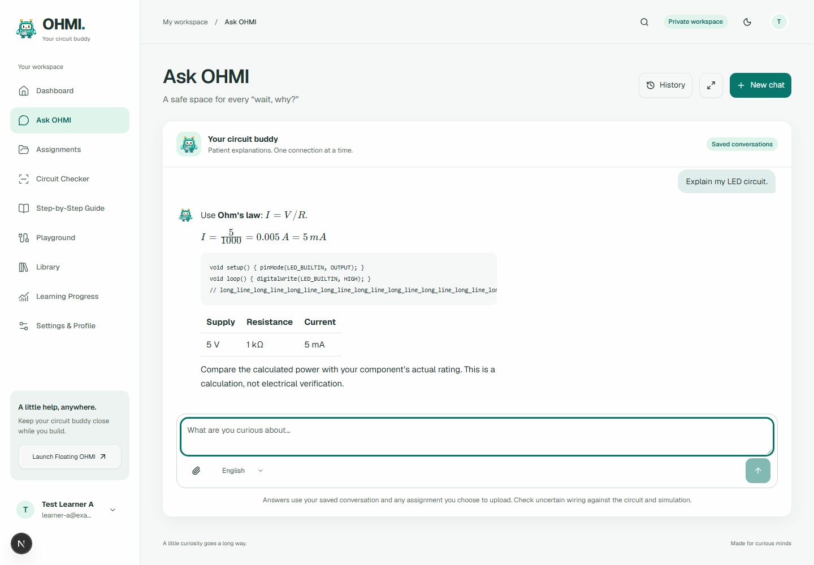
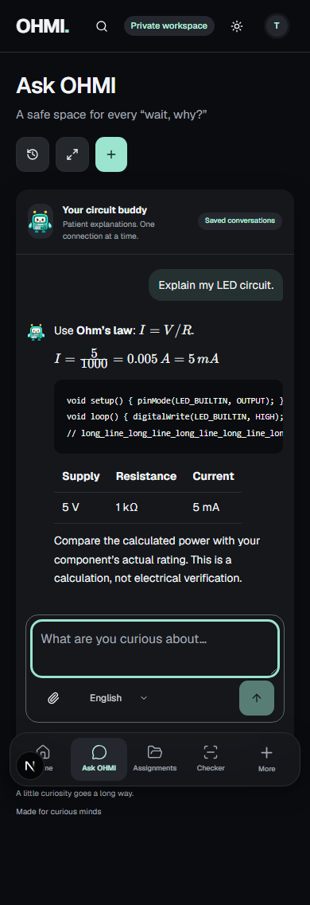

# Ask OHMI — focused chat refinement, 28 October 2026

## Brief plan

1. Inspect the supplied 24.7-second recording, screenshots, deployed chat configuration and exact send/recovery path.
2. Measure the existing UI and request flow with synthetic authenticated fixtures and fixed network/provider delays.
3. Refine only chat messages/loading: compact mint user bubbles, quiet avatar-led responses, no AI-reply label or skeleton cards, accessible errors/retry and reduced motion.
4. Remove redundant fresh-request preflights and plain-chat workspace refreshes without changing UUID idempotency, ownership, persistence, providers, existing timeout/accounting/burst protection or billing. Compact chat-only instructions while preserving electronics grounding, bilingual tutoring and complete code.
5. Verify comparable measurements, offline response-policy cases, saved/long history, desktop/mobile/themes, failures, account isolation and duplicate prevention. Commit, push and deploy the verified changes.

## Design contract

Existing OHMI identity and the approved pixel mascot remain authoritative. Treat this as an Operate/Read surface: readable 65–75ch answers, compact right-aligned mint messages, a small left mascot and open answer surface, 12–16px radii, restrained transitions, existing typography and themes. Keep local/limited disclosures when applicable; remove the repetitive AI-reply label. Preserve Markdown, math, code, attachment, history, continuation and failure controls.

The supplied recording/screenshots are the visual anti-reference. The saved reference catalog is consulted selectively; the public [Mobbin homepage](https://mobbin.com/) was visually inspected, but no paid app screens were accessed. The implementation follows the supplied conversation brief, not that site's marketing layout. No third-party artwork, new font, mascot redesign or unrelated page redesign.

One targeted dependency was justified during rendered verification: pinned `remark-gfm@4.0.1` renders Markdown tables instead of displaying raw pipes. Writing a partial Markdown parser would be larger and less reliable. HTML skipping, link sanitation and KaTeX trust limits remain unchanged.

## Budget and measurement contract

No live inference or billing changes. Deployed source and configured secret names verify the Groq120B default without revealing values. Existing provider routing is preserved; no automatic retry is added. Application token quotas removed in the preceding owner-approved release stay removed. Existing per-runtime burst guard, response ceilings, request leases/accounting and recovery remain.

Performance numbers must compare the same synthetic conversation, fixed network/provider timing and warmed local server. Report user-visible appearance separately from total completion. They do not establish real provider latency or generated-answer quality. Mocked evaluation cases test the policy/transport contract, never pretend to measure model weights or production reasoning.

## Changes and evidence

Deployed `ohmi-web` source was downloaded into ignored scratch space before edits. Its candidate resolver defaults to `openai/gpt-oss-120b` when the Groq credential exists; configured secret names confirmed that credential and no provider/model override. Existing routing/failover, response ceilings, 6.5-second attempt/22-second generation budgets, accounting, request leases and the per-runtime burst guard remain unchanged. No schema, student records, keys, billing settings or provider selection changed.

- `web-app/src/components/chat.tsx`, `web-app/src/app/globals.css`: compact mint user bubbles, open avatar-led answers, no AI-reply label or skeleton card, a small honest typing status, synchronous submission guard, no artificial scroll timer, and original-file/draft preservation on stop/retry. Existing continuation, attachments, errors and history actions remain.
- `web-app/src/lib/backend/ai.ts`: freshly minted UUIDs may POST immediately. Known retries still read recovery first; ambiguous fresh responses still recover the original UUID without another generation POST. Server atomic admission and ownership checks are unchanged.
- `web-app/src/components/app-provider.tsx`, `web-app/src/lib/backend/data.ts`: refresh only the relevant conversation after plain chat. Retain already loaded contiguous history; if another device creates a gap larger than a page, use the latest contiguous page so older pagination can recover the missing middle. A focused test reproduced this review finding before the fix.
- `web-app/src/components/rich-text.tsx`, `web-app/package.json`, `web-app/package-lock.json`: memoize unchanged Markdown, add pinned GFM table support, and make scrollable code/math/table regions keyboard reachable. HTML remains skipped and KaTeX retains `trust:false` and expansion/size limits.
- `supabase/functions/ohmi-ai/tutor-policy.ts`, `handler.ts`, `copilot.ts`: versioned chat-only policy `ohmi-chat-v1`, concise natural English/Filipino/Taglish, adaptive depth, explicit uncertainty and datasheet checks, and unchanged full code/context inputs. Groq reasoning uses supported `low` effort and excludes reasoning from displayed output, matching the project's existing Groq adapter. The 1600-token response ceiling is unchanged. [Groq reasoning parameter documentation](https://console.groq.com/docs/reasoning).

## Comparable measurements

Three warmed sends per version, same local authenticated fixture and question shape, browser latency60ms, Auth/Data fixture latency40ms, synthetic provider250ms. First warmup excluded. No real inference was made.

| Measurement | Before | After |
|---|---:|---:|
| Completion median | 1393 ms | 879 ms |
| Completion samples | 1388 / 1393 / 1403 ms | 879 / 883 / 877 ms |
| Browser API calls per fresh send | 3 | 1 |
| Auth/Data/provider fixture requests, median | 11 | 3 |
| Optimistic message DOM appearance | 57–64 ms | 48–58 ms |
| English chat system instruction, UTF-8 bytes | 4811 | 2273 |
| Taglish chat system instruction, UTF-8 bytes | 4901 | 2363 |

Controlled completion improved37%; system instruction bytes fell53%. These are not measured token counts or real Groq speed gains. The lifecycle trace identified unnecessary availability/recovery preflights and full-workspace refreshes around an otherwise unchanged generation call. Existing `Server-Timing` stages remain available for real backend investigation without exposing conversation content.

## Verification

- Root320offline tests and PWA57tests pass, including fresh UUID recovery, duplicate suppression contracts, contiguous-history merge and remote-device gaps.
- Eight focused offline policy cases cover compact instructions, English/Filipino/Taglish, basic resistor concepts, Ohm's law, LED current/rating uncertainty, unseen-circuit honesty and Arduino `INPUT_PULLUP`. Mocked provider answers prove the contract/format is preserved; they do not establish live model accuracy or language quality.
- Six responsive/theme combinations (1440/390/320px, light/dark) pass instant-message, single-POST, no-skeleton, no-AI-label, reduced-motion, Markdown/math/code/table, no-page-overflow and scoped Axe checks. Zero chat violations and zero page errors.
- Browser tests cover60-message history, a remote-device gap, stable reading position, lost acknowledgement with one provider POST, failed-question restoration, unrelated draft preservation on retry, account clearing, original-PDF continuation and private UUID recovery/cross-account rejection. Existing provider-parity browser checks pass with updated local/limited disclosures.
- Before/after benchmark and browser tests are reproducible in `web-app/tests/ask-performance.mjs` and `ask-polish-browser.mjs`, alongside existing recovery suites. Screenshots below contain synthetic fixture content only.

## Limits and release

No live generation was run, preserving the ₱0 work budget. Live reasoning quality/latency, physical devices and Safari are unverified. The previous Gemini3.8 media timeout is outside this Ask-only task. Existing provider limits and the prior application-quota policy remain unchanged. Four low-severity advisories remain in the existing math dependency stack; no unrelated force-upgrade was performed. The design tool reported stale metadata; it was left outside scope.

Both production builds, typechecks, Deno checks and deployed release identifiers are confirmed in the final handoff. GitHub push and Vercel/Edge release are explicitly owner-authorized; no next phase is started.
