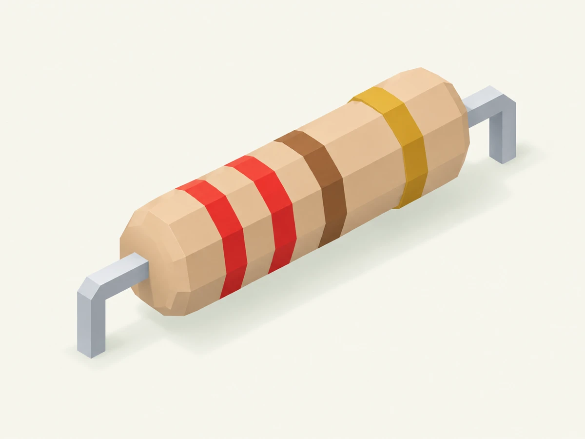
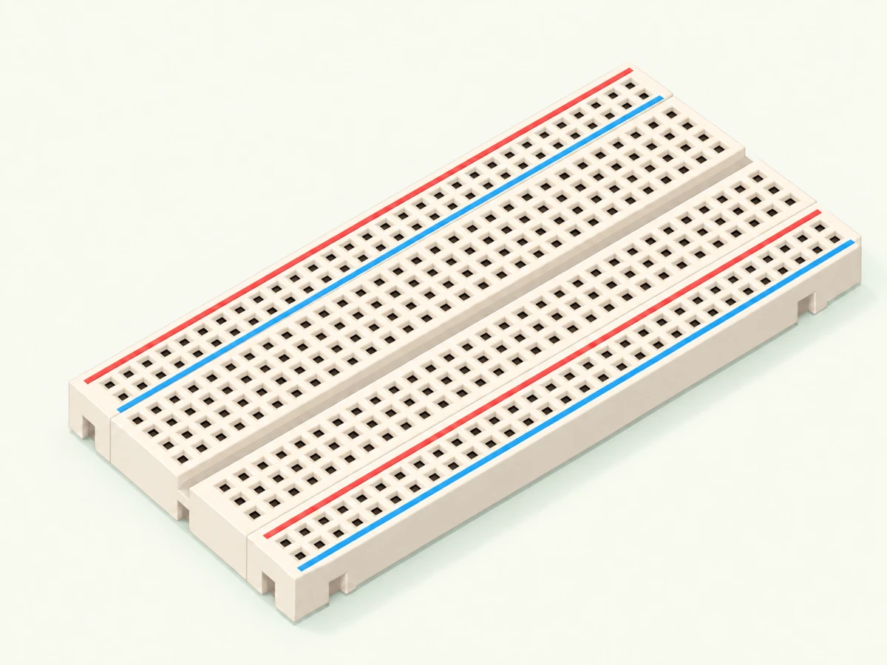
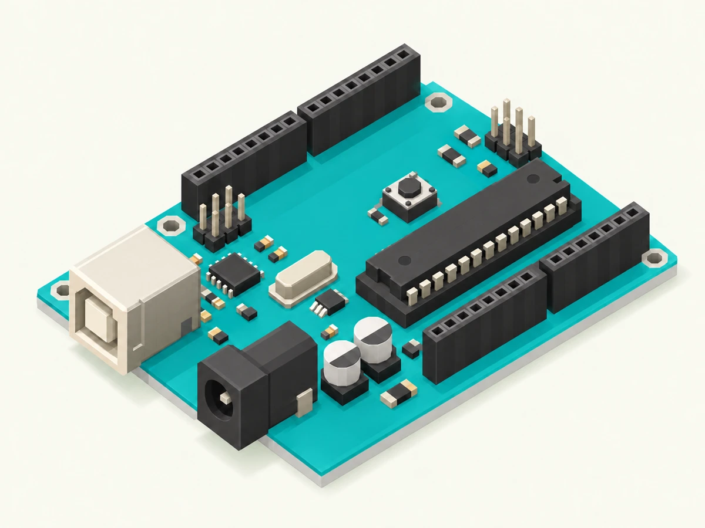

# OHMI Circuit Library: Soft Voxel sample review

Status: three-sample review; owner approval pending. Generated 24 October 2026 with built-in image_gen. This package does not implement the larger attached Library brief or authorize a production release.

## Shared illustration system

Use all three owner-supplied references together: the resistor supplies silhouette and material clarity, the breadboard supplies isometric structure and repeated detail, and the Uno supplies recognizable board layout. Preserve OHMI's existing mascot, teal identity, PWA layout and functionality.

- One isolated component in 4:3 landscape framing, long axis running lower-left to upper-right.
- Orthographic isometric camera, approximately 30-degree elevation; no dramatic perspective.
- Warm cream background with mint ambient cast, upper-left soft key light, diffuse mint-gray contact shadows.
- Matte, faceted forms, small bevels, restrained stepped edges and clean repeated details. No noise, faces, scenic props or decorative text.
- Match apparent object occupancy, not real-world scale between a resistor and a board. Normalize bounds during eventual card integration.
- Keep color meaningful: resistor value bands, breadboard rail stripes, turquoise PCB, graphite packages and silver connectors.

## Review samples

### Resistor

Two leads, tan axial body and red/red/brown/gold bands representing 220 ohms with 5% tolerance.

### Breadboard

Empty breadboard with center channel, terminal fields and paired power-rail socket rows. The refinement adds the missing second rail row on each edge. Do not infer electrical connectivity from the render.

### Arduino Uno

Turquoise board, USB Type-B socket, barrel power jack, DIP microcontroller, edge sockets and recognizable support components. The refinement removes an extra mounting hole and requests consistent pin counts. Artistic detail remains unsuitable for teaching exact pin positions or counts.

## Review and verification

The three candidates share the same prompt contract and all three reference inputs. Inspected generation outputs for framing, background, light, subject recognition and unwanted decorations. Breadboard and Uno received one focused correction pass. Exact socket and pin counts are not certified. These are recognition illustrations, not pinout diagrams or evidence of electrical safety.

Original PNG masters preserve generation provenance. WebP review copies are 1200 x 900; PNG masters are 1448 x 1086. Full generation prompts and refinement prompts are in [manifest.json](manifest.json). References are owner-supplied; no third-party asset was downloaded or copied from a reference site.

No runtime source, navigation, stylesheet, PWA cache or production configuration changed. App/browser regression tests are not applicable to this unintegrated artwork package. Web Interface Guidelines review is deferred until UI integration; there are no changed UI files to review.

## Approval boundary and handoff

Review all three together for unified camera, light, palette, proportions and detail density. Apply requested changes to the shared contract before producing more components. Approval of the Soft Voxel direction is recorded; approval of these specific samples is still pending. Remaining Library illustrations, production asset integration and the full interactive Library are not completed by this sample package.

After sample approval, reuse the shared contract and approved renders as style references for each remaining component. Review subject-specific terminals, polarity and geometry separately. Supply deterministic technical diagrams where learners need exact connectivity or pinouts. Preserve the existing PWA design and behavior. Do not deploy without explicit owner approval.
