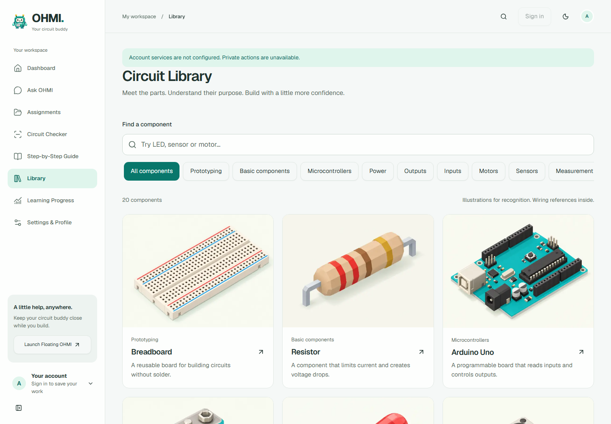
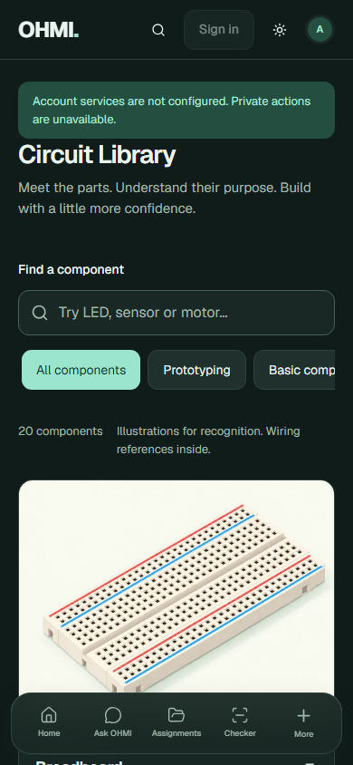

# Circuit Library illustration rollout verification

Date: 24 October 2026. Status: completed local integration, awaiting owner release approval.

## Result

The three owner-approved illustrations remain unchanged. Seventeen new images complete the 20-component starter collection. All use the approved trio as image references with a shared camera, cream/mint background, matte materials, faceting and soft upper-left lighting. New images were generated in batches of four, four, four, four and one using built-in image_gen. All final outputs were visually inspected; PNG masters preserve provenance.

All 20 delivery images are 1200 x 900 WebP, totaling **576,656 bytes**. Next Image supplies responsive delivery and below-fold lazy loading. Explicit image dimensions reserve space. There are no new dependencies. The renderer provides a readable failure state without hiding the component guide.

The integration adds `/app/library/` and 20 direct detail URLs, name/keyword search, category filters, related components, source links and separate technical references. Search and category state survive refresh in the URL. Rapid category/search changes read the current URL before updating it. Desktop sidebar and existing mobile More show Library; the bottom dock remains five items.

## Evidence

[Full collection](evidence/collection-desktop.png) · [category browsing](evidence/sensors-light.png) · [detail in light mode](evidence/detail-1440-light.png) · [detail in dark mode](evidence/detail-1440-dark.png) · [separate LED schematic](evidence/led-schematic.png) · [browser report](evidence/report.json).

## Verification performed

- `npm test`: **19 passed**, including three new catalog/image/approved-master checks. Existing backend-boundary and media tests pass.
- `npm run typecheck`: pass.
- `npm run build`: pass; Library and all 20 detail paths prerender.
- `node tests/library-browser.mjs`: pass on the final build at 1440 x 1000, 768 x 1024, 390 x 844 and 320 x 640 in light and dark themes.
- Browser checks cover search, categories, rapid category-to-search change, multiword search, invalid-category fallback, URL restore, browser Back, empty-state recovery, direct details, source links, all image decodes, keyboard flow, mobile More/dock containment and image failure recovery.
- Axe WCAG A/AA scans of Library and detail at all eight size/theme combinations: **zero violations**. No page errors or page overflow.
- Visual review: collection, desktop and mobile, light and dark. Separate topology diagrams were checked against cited contact relationships. Corrections join the diode symbol, selected switch throw and potentiometer wiper to their intended contacts.
- Latest Web Interface Guidelines reviewed against changed UI files: dimensions, alt text, native links/buttons, visible search label, focus, live result count, URL state and reduced motion preserved.
- Impeccable detector: advisory findings only. Cream artwork background is owner-approved; 13/15/16/18/28px sizes match existing app usage or scoped Library hierarchy despite a stale design sidecar. No design-system overhaul was performed.
- `git diff --check`: pass.

The pre-existing full `tests/browser.mjs` traversed existing routes at six sizes and reached the signed-out private-API checks. It then stopped at its expected 401 assertion because this isolated checkout lacks the local origin/auth test configuration (400 returned). It is **not reported as a full pass**. Automatic approval review rejected a proposed separate local test-server configuration with “blocked by policy”; no test-server or hosted configuration was changed. The scoped Library browser suite passed independently. No live auth, private-data, AI or production tests were run.

Existing build warnings remain: unpdf's import.meta warning and Node module-type warnings in unchanged backend code. These do not fail checks.

## Technical review and reference coverage

Illustrations establish recognition, not exact electrical geometry. Datasheet pin order, component ratings, wiring and polarity instructions live separately from the images. Six entries use local electrical diagrams: breadboard contact groups, an LED series example (also used by resistor), diode polarity, SPDT topology and potentiometer wiper topology. The other entries link directly to separate manufacturer pinouts, technical drawings or educator wiring references. Local diagrams are original geometry checked against those sources; third-party drawings were not copied.

The LED schematic uses an example 330-ohm resistor with a 5 V source and approximate 2 V LED drop, about 9 mA. It is explicitly distinct from the 220-ohm recognition artwork. Exact device ratings must still be checked.

| Component | Reference checked | Recognition review |
| --- | --- | --- |
| Breadboard | [SparkFun](https://learn.sparkfun.com/tutorials/how-to-use-a-breadboard/all) | Original owner-approved sample retained; dense pin/socket details remain stylized. |
| Resistor | [SparkFun](https://learn.sparkfun.com/tutorials/resistors/all) | Original owner-approved sample retained; dense pin/socket details remain stylized. |
| Arduino Uno | [Arduino](https://docs.arduino.cc/hardware/uno-rev3) | Original owner-approved sample retained; dense pin/socket details remain stylized. |
| 9 V battery | [Energizer](https://data.energizer.com/pdfs/522.pdf) | Two different snap shapes on a rectangular 9 V battery body; no polarity labels invented. |
| LED | [Adafruit](https://learn.adafruit.com/adafruit-arduino-lesson-2-leds/leds) | Two leads and a recognizable red lens; detailed polarity is taught separately. |
| Pushbutton | [Adafruit](https://learn.adafruit.com/adafruit-arduino-lesson-6-digital-inputs/push-switches) | Square tactile housing and central plunger; three legs visible, far fourth leg occluded by body. |
| Slide switch | [Adafruit](https://www.adafruit.com/product/805) | Sliding actuator and three terminals; electrical common/throw relation shown in a separate topology diagram. |
| Potentiometer | [SparkFun](https://learn.sparkfun.com/tutorials/resistors/all) | Rotary shaft, round housing and three lugs; wiper relation shown separately. |
| Piezo buzzer | [Adafruit](https://www.adafruit.com/product/160) | Single sound opening and two leads; no speaker cone or extra terminal. |
| DC motor | [Adafruit](https://learn.adafruit.com/adafruit-arduino-lesson-13-dc-motors) | Single shaft, metal motor can, ventilation slots and two rear tabs. |
| Servo motor | [Adafruit](https://learn.adafruit.com/adafruit-arduino-lesson-14-servo-motors/servo-motors) | Mounting ears, horn and three-conductor cable; exact socket cavities are stylized. |
| Ultrasonic sensor | [Adafruit](https://learn.adafruit.com/ultrasonic-sonar-distance-sensors/pinouts) | Two matching transducers and a four-pin header; source distinguishes four-pin and other module variants. |
| Temperature sensor | [Analog Devices](https://www.analog.com/media/en/technical-documentation/data-sheets/TMP35_36_37.pdf) | Flat-front TO-92 package with three leads; not distinguishable from a transistor by silhouette alone. |
| Photoresistor | [Adafruit](https://learn.adafruit.com/photocells) | Two leads, flat disk and visible serpentine sensing pattern. |
| RGB LED | [Adafruit](https://learn.adafruit.com/adafruit-arduino-lesson-3-rgb-leds/arduino-sketch) | Four leads and one diffused package; common-anode/cathode order is deliberately not inferred from the render. |
| Jumper wires | [SparkFun](https://learn.sparkfun.com/tutorials/connector-basics/all) | One continuous insulated male-to-male jumper with one exposed pin per end. |
| Multimeter | [SparkFun](https://learn.sparkfun.com/tutorials/how-to-use-a-multimeter/all) | LCD, rotary selector, three sockets and two continuous probe leads; not a mode/lead-placement diagram. |
| Capacitor | [SparkFun](https://learn.sparkfun.com/tutorials/capacitors/all) | Radial two-lead can, top vent and sleeve stripe; exact ratings and polarity must come from actual markings. |
| Diode | [Vishay](https://www.vishay.com/docs/88503/1n4001.pdf) | Axial two-lead body with one cathode band. |
| NPN transistor | [SparkFun](https://learn.sparkfun.com/tutorials/transistors/all) | TO-92 body and three leads; no universal pin order claimed. |

Adafruit's physical diagrams may use parts different from a simulator's selected model. The entry tells students to match the exact variant. Direct SparkFun access returned 403; its article contents were read through Agent Reach's documented Jina reader. No external artwork was downloaded or embedded.

## Preserved scope and limits

Backend, authentication, private records, AI, original mascot, existing feature source, global stylesheet, service worker and hosting configuration are unchanged. Only the shell's Library navigation mapping and nested-route label changed outside new Library files. The worker still caches only its explicit public shell; this change does not promise offline access to the entire Library.

The source `web-app/vercel.json` and `website/vercel.json` disable automatic Git deployment for this review branch. No deployment command was run, no production branch was changed and no hosted settings were updated.

No live Tinkercad editor/catalog verification was performed. This is a 20-component electronics recognition library, not a complete or version-certified Tinkercad catalog. Dense Uno/socket details are stylized. TMP36 and NPN TO-92 packages can look nearly identical, so the guide explicitly requires markings/datasheets. Physical phones, Safari, screen readers and real electrical hardware were not tested.

The existing PRODUCT.md and Impeccable design sidecar are stale; their repair was kept out of scope. The skill offers `/impeccable init` and `/impeccable document` for a later metadata refresh.
